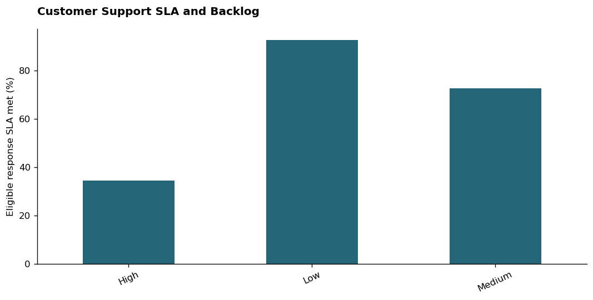
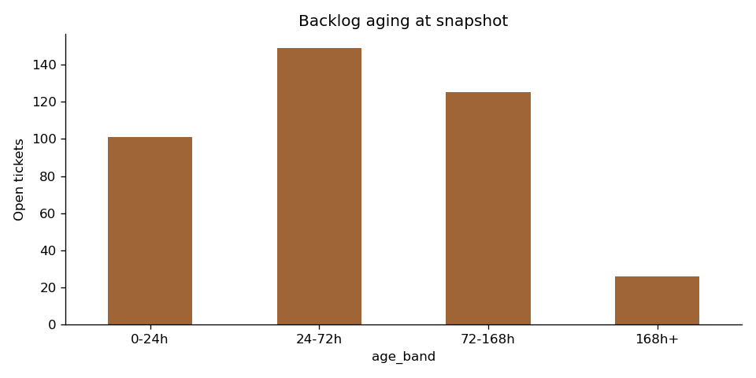

# Customer Support SLA and Backlog

Where is the support queue missing service commitments?

## Overview

A support manager needs to separate first-response delays from unresolved ticket backlog. This advanced portfolio case study contains an original dataset, executable Python and SQL, a notebook with saved outputs and an offline dashboard.
**Data status:** Synthetic. **Observation period:** Fictional 2025. 

## Problem statement

- **Business question:** Where is the support queue missing service commitments?
- **Task:** Measure response SLA compliance by priority and aging of open tickets at a fixed snapshot.
- **Skills demonstrated:** SLA logic · missing outcomes · backlog aging.
- **Decision supported:** Prioritize an investigation or controlled test using reproducible evidence.

## STAR case study

### Situation
A support manager needs to separate first-response delays from unresolved ticket backlog.

### Task
Measure response SLA compliance by priority and aging of open tickets at a fixed snapshot.

### Action
Apply priority-specific thresholds, retain unresolved tickets in backlog and report satisfaction response coverage. The workflow includes source profiling, explicit metric definitions, Python calculations, SQL checks and a documented handoff.

### Result
The executed analysis produced Eligible response SLA met (%): 70.8634; Open tickets: 401.0000; CSAT response coverage of closed (%): 55.5986. The notebook also exports a group-level summary and an SQL reconciliation. These are measured analytical outputs from synthetic data; no operational improvement has been demonstrated.

## Dataset

- **Availability:** Included at [`data/raw.csv`](data/raw.csv).
- **Source:** Original simulation in [`generate_data.py`](generate_data.py), seed `202609`.
- **Dictionary and grain:** [`data/README.md`](data/README.md).
- **License:** Included synthetic data is CC0-1.0; code is MIT licensed.
- No external data download, credentials or personal records are required.
- Simulated relationships are teaching assumptions, not facts about an industry.

## KPI definitions and analytical decisions

One row per ticket created in December. Snapshot 2026-01-01. First-response targets: High 4h, Medium 12h, Low 24h. Pending unresponded tickets still within target are excluded from the SLA denominator; overdue unresponded tickets count as misses. CSAT coverage denominator is closed tickets.

Apply priority-specific thresholds, retain unresolved tickets in backlog and report satisfaction response coverage.

## Project workflow

1. Read the source and inspect its grain, missing values and duplicates.
2. Validate the data contract and handle fields according to their business meaning.
3. Calculate the defined metrics and segment-level summaries.
4. Run SQLite aggregation and reconcile shared measures against Python.
5. Generate the chart, CSV exports and standalone HTML dashboard.
6. Interpret the evidence, document limits and propose a next validation step.

## Verified results

The notebook was executed against the included dataset with an isolated in-process IPython session. Tables, printed checks and chart outputs remain embedded in the notebook.

| Metric | Executed value |
|---|---:|
| Eligible response SLA met (%) | 70.8634 |
| Open tickets | 401.0000 |
| CSAT response coverage of closed (%) | 55.5986 |

These values describe this synthetic dataset and dependency environment. They are a reproducibility record, not a production benchmark or a causal effect unless explicitly defined in the randomized experiment.



## Evidence-based recommendation

High has the lowest eligible first-response SLA compliance (34.43%). Investigate triage and staffing while retaining overdue unanswered tickets in the metric.



The notebook contains the supporting breakdown in `outputs/detail.csv`. This recommendation is an investigation or validation step, not a claim of achieved impact.

## Dashboard and output files

Download or clone the project and open [`outputs/dashboard.html`](outputs/dashboard.html) in a browser. It works offline and provides KPI cards, a chart and a searchable summary table. The text filter only filters table rows; it does not recompute cards or charts. GitHub's file view does not execute HTML dashboards.

| File | Purpose |
|---|---|
| [`analysis.ipynb`](analysis.ipynb) | Narrative analysis with executed code, tables and chart |
| [`analysis.py`](analysis.py) | Script companion with the same analysis code |
| [`analysis.sql`](analysis.sql) | SQLite aggregation over validated `facts` |
| [`outputs/metrics.json`](outputs/metrics.json) | Machine-readable verified KPIs |
| [`outputs/summary.csv`](outputs/summary.csv) | Group-level analysis for Excel or BI tools |
| [`outputs/analysis_ready.csv`](outputs/analysis_ready.csv) | Validated analysis facts |
| [`outputs/sql_results.csv`](outputs/sql_results.csv) | SQL query results |
| [`outputs/data_quality.csv`](outputs/data_quality.csv) | Source profiling evidence |

## How to run

From the repository root:

```bash
python -m venv .venv
source .venv/bin/activate
# Windows PowerShell: .venv\Scripts\Activate.ps1
python -m pip install -r requirements.txt
cd data-analytics/10-support-sla-analytics
python -m jupyterlab analysis.ipynb
```

Run notebook cells from top to bottom. To execute as a script from the project directory:

```bash
python analysis.py
```

To rebuild the original dataset:

```bash
python generate_data.py
```

From the repository root, execute all notebooks and save their real outputs:

```bash
python scripts/execute_all.py
```

## Power BI / Tableau extension

Import `outputs/analysis_ready.csv` and `outputs/summary.csv`. Rebuild the specified measures with ratio-of-sums where relevant, add segment filters and reconcile the unfiltered totals to `outputs/metrics.json`. This package includes an HTML dashboard, not a PBIX or Tableau workbook.

## Limitations

SLA is measured in elapsed hours, not business hours. Resolution duration applies only to closed tickets and has survivor bias. CSAT is voluntary.

## Recommended next step

Introduce business calendars, censored time-to-resolution analysis and staffing experiments.

## Interview preparation

- What decision does this analysis support and what is the unit of analysis?
- Why did you choose this denominator and how could another denominator mislead?
- What did the data checks and SQL reconciliation establish?
- Which finding would you investigate first and what evidence would change your recommendation?
- What does this dataset prevent you from concluding?

### 60-second STAR answer

“In this simulated case study, a support manager needs to separate first-response delays from unresolved ticket backlog. My task was to measure response SLA compliance by priority and aging of open tickets at a fixed snapshot. I used Python and SQL to validate the source, calculate defined metrics and communicate the results through a dashboard. The resulting metrics are recorded above. I would next introduce business calendars, censored time-to-resolution analysis and staffing experiments.”

## Technologies

Python, Pandas, NumPy, SQLite, Matplotlib, Jupyter and HTML. The A/B testing project additionally uses SciPy.


